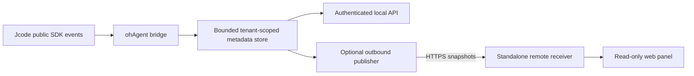

# Live activity panel and remote publishing

## Scope

Open `/progress` in the React dashboard. The page is a read-only EN/LV/RU workbench
showing sessions, actual tool execution counts, current tool, latest provider-call
input/output tokens, permission waits, terminal outcomes and a bounded event trail.
Working and waiting sessions are prioritized. Browser refreshes run every three
seconds, without overlapping requests, and stop on access denial.

This observes **sessions executed through ohAgent's public Jcode SDK bridge**.
It does not silently discover unrelated Jcode/Claude terminal sessions. Existing
in-process OpenAI/WebSocket execution paths are not part of this projection.
Plan text and subagent hierarchy are not currently projected. No percentage,
financial cost or cumulative token usage is inferred from incomplete events.
The Jcode submodule and agent execution policy are unchanged.

## Data flow



Local `GET /api/progress?tenant_id=...` uses the daemon's existing **operator API
key** in `Authorization: Bearer`. That credential is administrator-level, not a
customer token. Tenant is mandatory and never defaults to an aggregate. Do not
share the daemon key with remote viewers or expose the daemon merely to monitor it.

The standalone receiver hosts no agent execution, keys, memory or admin endpoints.
It binds to loopback by default and serves only `/`, `/progress`, `/assets/*`, and
the progress API. Its read credential can only read its configured tenant. Its
publish credential can only submit snapshots for that tenant. A tenant query is
not itself authorization. Run a separate receiver with distinct credentials for
each security domain. Publishers in one receiver's tenant share the publish
credential, so use distinct receivers if sources need mutually untrusted scopes.

## Privacy and resource limits

- SDK events are matched by session ID before projection. Raw session identifiers
  are replaced with tenant-local SHA-256-derived 24-hex identifiers.
- No prompts, assistant text, reasoning, tool input/output, file paths, raw errors,
  permission descriptions, or credentials are stored or transmitted. Tenant ID,
  source ID, tool names, state, timestamps and usage are operational metadata:
  choose non-sensitive identifiers. Tool names are restricted to bounded identifiers.
- SDK launcher overrides the two monitoring-token environment variables with empty
  values before starting Jcode, so agent tools do not inherit them directly. This
  is not an OS sandbox: same-user processes or host access remain a separate trust
  boundary. Configure host isolation for untrusted workloads.
- The browser holds the read token only in component memory, never URL parameters,
  browser storage or cookies. Disconnect clears its connection and displayed data.
  A browser extension or compromised same-origin script can still access memory.
- Local memory holds at most 128 sessions globally, each with 64 tool counters and
  24 recent transition events. Least recently updated sessions are evicted.
- Receiver accepts at most 32 source snapshots, 128 sessions per snapshot and 1 MiB
  per request. Unknown JSON fields and oversized nested collections are rejected.
- Receiver keeps only the newest snapshot per source **in memory**, not a durable
  audit trail. Restart clears it, and the next publisher heartbeat restores it.
- Snapshot timestamps must be within two minutes of receiver time. Keep clocks
  synchronized. Sequence numbers and boot IDs reject out-of-order updates.
  Retrying an identical sequence is idempotent and does not refresh liveness.
  Reusing a sequence with changed content returns `409`.
- A receiver marks a publisher stale after 90 seconds without a new heartbeat.
  A stopped laptop does not make an old working state look newly completed.
- Publisher sends the latest snapshot every five seconds, including an empty
  heartbeat. Failures back off to 60 seconds. There is no growing event queue.
  Connect/request timeouts are 3/8 seconds. Redirects are disabled. Publishing
  failure never blocks agent execution. Restart the daemon to change its config.

## Build

From the repository root:

```bash
cargo build --release -p ohagent-progress --bin ohagent-progress-server
npm --prefix crates/ohagent-dashboard ci
npm --prefix crates/ohagent-dashboard run build
```

Use `cargo metadata --format-version 1 --no-deps` to find Cargo's `target_directory`.
This checkout configures an external Cargo target directory. Vite independently
writes the web bundle to the repository's `target/dashboard-dist`.
Transfer the built binary and that directory to the intended server using your
approved deployment mechanism. Building or copying a binary is not approval to
restart an existing production service.

## Receiver configuration

Supply existing, approved credentials through your chosen secret-management
mechanism. This feature does not generate, install or log real secrets. Obtain
owner approval for storage and credentials before provisioning any new ones.
Do not put tokens on command lines, in shell history or in committed env files.

| Environment variable | Meaning |
| --- | --- |
| `OHAGENT_PROGRESS_TENANT_ID` | Required explicit tenant identifier |
| `OHAGENT_PROGRESS_VIEW_TOKEN` | Required existing read credential, at least 24 bytes |
| `OHAGENT_PROGRESS_PUBLISH_TOKEN` | Required different existing write credential, at least 24 bytes |
| `OHAGENT_PROGRESS_WEB_ROOT` | Absolute path to copied dashboard bundle, default `target/dashboard-dist` |
| `OHAGENT_PROGRESS_BIND` | Listen address, default `127.0.0.1:9191` |

After approved configuration, run `ohagent-progress-server`. Visit `/progress`
through a TLS reverse proxy or an authenticated SSH tunnel. The root redirects to
`/progress`. Security headers enforce no-store, no-referrer, nosniff and a restrictive
same-origin CSP. The web bundle is public, but progress data always needs a token.

Before publishing on the internet, configure TLS, firewall restrictions, request
rate/concurrency limits and a request-body cap of 1 MiB at your existing proxy.
Do not expose the receiver's plaintext HTTP port directly. Do not relax CORS.
No production infrastructure, DNS, TLS, services or secrets are changed by the
implementation or its acceptance tests.

## Publisher configuration on the ohAgent host

| Environment variable | Meaning |
| --- | --- |
| `OHAGENT_PROGRESS_REMOTE_URL` | Full `https://<approved-monitor>/api/progress/snapshots` URL |
| `OHAGENT_PROGRESS_PUBLISH_TOKEN` | Existing receiver write credential |
| `OHAGENT_PROGRESS_TENANT_ID` | Exact tenant whose sessions should be published |
| `OHAGENT_PROGRESS_SOURCE_ID` | Stable unique source identifier, e.g. `workstation` |

Publishing is **off by default**. When the URL is set, all remaining fields are
required. Only HTTPS is accepted, except HTTP to literal loopback/localhost for
local checks or an SSH tunnel. Embedded credentials, query parameters, fragments
and alternate API paths are rejected. Invalid configuration disables only the
publisher with a non-secret warning. Exactly one tenant is published per daemon
publisher. The publisher starts/stops with the daemon and uses a fresh boot ID
after restart. No new inbound port is required on the working machine.

In the remote browser enter that tenant ID and the **read token**, never the
publish token or daemon admin key. Read and write credentials cannot be equal.

## Protocol

- `POST /api/progress/snapshots`: Bearer publish token and version-1 metadata
  snapshot, `204` on accepted/idempotent update, `403` on wrong tenant, `409` on
  out-of-order state, `422` on invalid metadata, `429` on source capacity.
- `GET /api/progress?tenant_id=...`: Bearer read token, returns an array of
  `{ received_at, stale, snapshot }` records. Missing/incorrect tokens get `401`.
- Local daemon GET uses the same response envelope, but its existing operator auth.
- Snapshot fields: `version`, `tenant_id`, `source_id`, `boot_id`, `sequence`,
  `generated_at`, `sessions`. Timestamps are Unix milliseconds. Session usage is
  the latest provider call, not cumulative billing. This is not a full UHP API.

## Repeatable validation

```bash
cargo test -p ohagent-progress
cargo test -p ohagent-core --lib
cargo test -p ohagent-core --test jcode_sdk_runtime_boundary_test
cargo check -p ohagent-daemon
cargo clippy -p ohagent-progress --all-targets -- -D warnings
npm --prefix crates/ohagent-dashboard run build
cargo build -p ohagent-progress --bin ohagent-progress-server
python3 scripts/progress_panel_smoke.py --binary /path/to/cargo-target/debug/ohagent-progress-server
```

The browser smoke test needs Python Playwright and its Chromium installation. It
starts a real temporary loopback receiver using synthetic fixture tokens and the
actual built web assets. It tests HTTP authentication and tenant boundaries,
read/write separation, security headers, live publication-to-browser updates,
filtering, EN/RU/LV, a 390px mobile layout, stale-publisher indication, disconnect
and invalid-token errors. It stops its own server and does not use real provider
calls, production credentials, deployed agents or remote infrastructure.

### Observed acceptance, 2026-11-19

- Monitoring crate: 9 tests passed, including a real HTTP publisher/receiver round trip.
- Core library: 88 tests passed, including SDK metadata redaction and interrupted-turn semantics.
- SDK runtime boundary integration suite: 7 tests passed.
- Daemon library: 33 tests passed. Daemon/core compile checks passed.
- Strict Clippy for the new monitoring crate and formatting checks for changed Rust files passed.
- Production dashboard build and real-server Playwright desktop/mobile workflow passed.
  Network-loss preservation/recovery, stale heartbeats, three languages and denied access
  were exercised. Synthetic desktop and mobile screenshots were visually inspected.
- The full workspace suite was not run. Existing warnings in other crates remain outside
  this change. No paid model-driven session, real remote host, production restart or
  credential provisioning was used as acceptance evidence.
